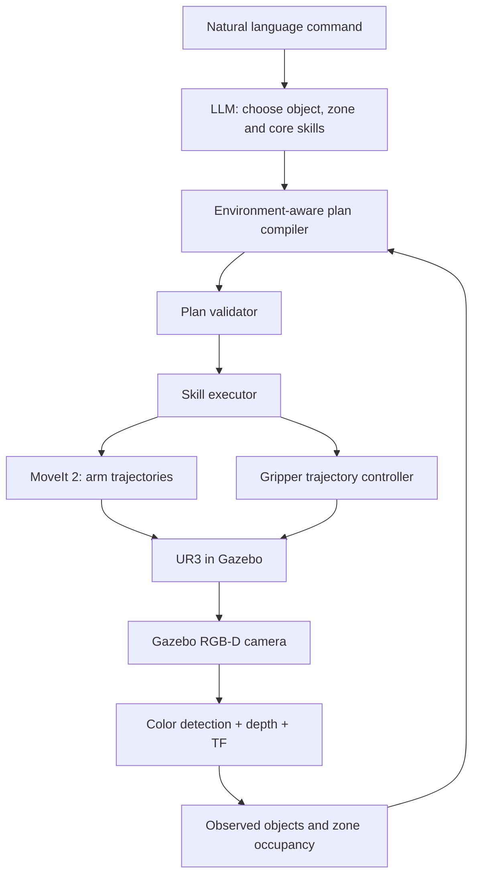

# Bài thực hành 03 — LLM Skill Planning với UR3, Gripper và Camera

Package `ur3_llm` dựng một demo ROS 2 độc lập trên Gazebo Classic/Humble. Robot dùng UR3, gripper hai ngón có khớp điều khiển thật trong mô phỏng, camera RGB-D nhìn từ trên xuống, MoveIt 2 và một LLM planner tương thích OpenAI Chat Completions.

## Kiến trúc



LLM chỉ trả về ba skill cơ bản `pick(object)`, `place(object, zone)` và `home()`. Nó không nhận giao diện để gửi joint command, tọa độ Cartesian, pose hoặc trajectory. Planner kiểm tra quan sát camera, chèn các skill xử lý zone bị chiếm và tạo tọa độ tạm từ danh sách ứng viên đã được camera xác nhận trống. Validator mô phỏng trạng thái block theo từng bước trước khi executor gọi MoveIt và controller gripper.

## Trường hợp demo bắt buộc

World được khởi tạo với `blue_cube` nằm trong `zone_b`. Hãy yêu cầu:

```text
Put the red cube in Zone B.
```

Camera phát hiện block và báo `zone_b.occupied_by = blue_cube`. Kế hoạch mở rộng sẽ có dạng:

```text
check_zone(zone_b)
find_free_position(blue_cube) -> camera-checked table position
pick(blue_cube)
place(blue_cube, temporary_position)
pick(red_cube)
place(red_cube, zone_b)
home()
```

Mỗi lần gắp/thả được thực hiện bởi chuyển động UR3 và các ngón gripper trong Gazebo. Camera xác nhận block được nâng nếu nhìn thấy; nếu thân gripper che block trong góc nhìn top-down, executor tiếp tục giữ và bắt buộc camera xác nhận block sau khi thả. Không có service nào đặt pose trực tiếp cho block.

## Cài đặt và chạy

Package cần ROS 2 Humble, Gazebo Classic, `ur_description`, `gazebo_ros2_control`, MoveIt 2, `cv_bridge`, OpenCV, TF2 và các ROS 2 controllers. Đây là package cho Gazebo Classic (`gazebo_ros`), không phải Gazebo Sim.

Trong workspace `ur_gz`:

```bash
cd ~/workspaces/ur_gz
colcon build --packages-select ur3_llm --symlink-install
source install/setup.bash
```

Terminal 1 — khởi chạy world, robot, camera, controllers và MoveIt. Cửa sổ
OpenCV hiện ảnh camera trực tiếp cùng nhãn block, tọa độ trong `base_link`, và
trạng thái trống/đang chiếm của ba zone:

```bash
ros2 launch ur3_llm simulation.launch.py
```

Để ẩn cửa sổ Gazebo nhưng vẫn xem camera, dùng `gui:=false`. Chạy hoàn toàn
headless bằng `gui:=false camera_window:=false`. Ảnh đã gắn nhãn vẫn được
publish trên `/vision/debug`; cửa sổ OpenCV cần phiên desktop có màn hình.

Terminal 2 — mở LLM endpoint theo OpenAI Chat Completions nếu dùng gateway, rồi chạy executor:

```bash
export LLM_BASE_URL=http://localhost:20128/v1
export LLM_MODEL=oc/muse-spark-1.3-contributor-free
export LLM_API_KEY=none
ros2 run ur3_llm executor
```

Nếu endpoint không sẵn sàng, parser cục bộ hiểu tên năm màu và `Zone A/B/C` để demo vẫn chạy được; log cho biết planner đang dùng fallback. Tắt LLM tường minh bằng `LLM_ENABLED=false`.

Kiểm tra dữ liệu camera trong terminal khác:

```bash
ros2 topic echo /vision/objects --once
```

Thông điệp JSON chứa vị trí block trong `base_link`, zone nào trống và block nào đang chiếm từng zone. Ảnh đã gắn khung nhận dạng được publish tại `/vision/debug`. Camera Gazebo publish RGB-D ở `/overhead_camera/camera/image_raw` và `/overhead_camera/camera/depth/image_raw`.

## Các package/file chính

- `urdf/ur3_llm.urdf.xacro`: UR3, gripper hai khớp trượt và camera RGB-D.
- `worlds/ur3_sorting.world`: bàn, ba marker zone và năm block; `blue_cube` ban đầu nằm trong `zone_b`.
- `ur3_llm/vision_node.py`: phân đoạn màu, lấy depth, đổi điểm camera sang `base_link`, suy ra zone occupancy.
- `ur3_llm/llm_planner.py`: LLM-to-JSON plan, schema nghiêm ngặt và local parser dự phòng.
- `ur3_llm/plan_validator.py`: thêm bước dọn zone và kiểm tra toàn bộ plan với trạng thái camera/workspace.
- `ur3_llm/robot_skills.py`: MoveIt pose/joint goals, action trajectory cho gripper và collision scene lấy từ camera cùng mặt bàn.
- `ur3_llm/executor.py`: camera freshness, xác nhận gắp/thả, thực thi plan tuần tự và dừng khi một bước lỗi.
- `config/scene.yaml`: hiệu chuẩn zone, giới hạn reach, độ cao thao tác và vị trí ứng viên cho vùng tạm.

## Quy tắc an toàn trong demo

1. Không có camera state mới hơn giới hạn cấu hình thì không lập kế hoạch.
2. Object/zone không được camera xác nhận thì không được dùng trong plan.
3. Validator chỉ chấp nhận đúng chuỗi skill cho zone trống, zone bị chiếm hoặc object đã ở đúng zone.
4. Vị trí tạm phải nằm trong reach, cách các block khác một khoảng an toàn và không nằm trong zone.
5. Executor kiểm tra lại zone/vị trí tạm trước khi dùng; nếu môi trường khác plan thì dừng để lập kế hoạch lại.
6. Sau pick/place, camera phải xác nhận trạng thái mới trước khi robot tiếp tục.
7. `Ctrl+C` gửi cancel tới action đang chạy trước khi đóng executor.

Các tọa độ zone và vùng thao tác là tham số hiệu chuẩn trong `config/scene.yaml`; vị trí block đang nằm đâu luôn lấy từ camera RGB-D. Khi đổi vị trí camera hoặc cách lắp robot, cần hiệu chuẩn lại zone, hướng camera và các độ cao trong file cấu hình.
